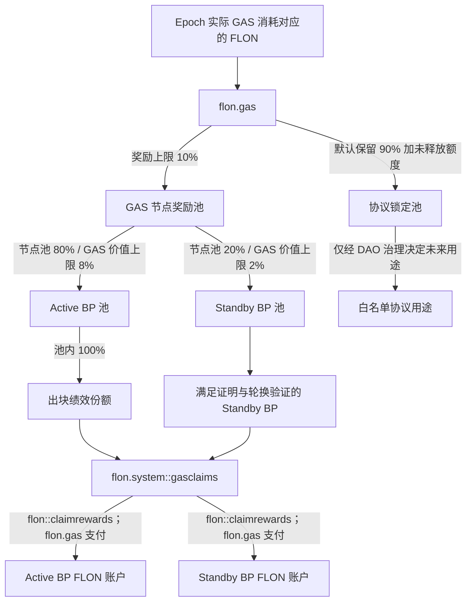

# FLON Gas 节点奖励设计

## 1. 目标与结论

每个结算周期（epoch）将链上**实际消耗 Gas 对应的 FLON** 的 10% 计入节点奖励池，由 21 个活跃节点和最多 30 个合格备用节点分享。设计必须满足：

- 所有共识节点从同一链上输入得到完全相同的账本结果；
- 不把 `flon.gas` 的充值或 `buygas` 金额误认为当期已消耗 Gas；
- 不按外部监控数据直接发币；
- epoch 边界只做常数时间封账；每个 BP 可重复触发但只能成功结算一次；
- 分配、领取、舍入余数和未分配余额始终守恒；
- 节点领取采用 pull 模式，不在 `onblock` 中遍历或转账，也不要求先完成全局批量结算。

当前实现由 `flon.system` 负责资格、绩效、GAS Epoch 封存及 `gasclaims` 领取记录；奖励资产继续由 `flon.gas` 持有。节点通过统一的 `flon::claimrewards(caller, producer, max_steps)` 主动领取，基础奖励由 `flon` 支付，GAS 奖励由 `flon.gas` 支付，不再要求节点调用独立的 `gas.reward::claimrewards`。

## 2. 当前链上资产语义

`flon.gas` 实际持有 `flon.token` 发行的 FLON。Gas 是资源计量单位，不应再创建一个可流通的 ELON 作为中间奖励币。

当前存在两条进入 `flon.gas` 的路径：

1. `buygas`：用户预先把 FLON 转入 `flon.gas`，同时获得 reserved gas；
2. 原生资源扣费：当交易从流动 FLON 支付 Gas 时，core 直接把相应 FLON 从付款人余额移入 `flon.gas`。

因此不能简单使用 `flon.gas` 的余额增量作为“当期 Gas 消耗”：预付 Gas 在购买时增加余额，但可能在后续 epoch 才被消耗。

## 3. 收入确认

### 3.1 共识级累计计数器

在 core 的资源结算路径增加单调递增的共识状态：

```text
total_gas_consumed
total_gas_value_flon
```

- `total_gas_consumed`：实际结算的 Gas 原子单位累计值；
- `total_gas_value_flon`：按协议内确定性换算规则得到的 FLON 最小单位累计值；
- reserved gas 和流动 FLON 支付都只在**实际消耗发生时**累计一次；
- `buygas` 只改变预付余额，不增加已消费累计值；
- 失败交易按照协议实际计费结果累计；不计费的失败交易不得累计；
- 计数器进入 snapshot、重放和状态承诺路径。

通过受协议特性保护的只读 intrinsic 暴露：

```text
get_gas_fee_totals() -> {
  total_gas_consumed,
  total_gas_value_flon
}
```

系统合约只读取累计值，不接受预言机提交的 Gas 收入。

### 3.2 Epoch 收入

```text
epoch_gas_value = total_gas_value_flon(end) - total_gas_value_flon(start)
node_pool       = floor(epoch_gas_value * node_reward_bps / 10_000)
node_reward_bps = 1_000  // 10%
```

所有运算使用 FLON 最小单位和 `int128` 中间值。禁止浮点数。

## 4. Epoch 与资格快照

建议首版 epoch 为 6 小时。每个 epoch 开始时冻结：

```text
epoch_id
start_slot / end_slot
active_schedule_hash
active_nodes[]       // 最多 21
standby_nodes[]      // 最多 30
reward_parameters_hash
gas_total_start
```

节点集合必须来自上一 epoch 已完成的合格候选人排名，不能在结算时按最新票数回溯修改。活跃与备用账户不能重复出现。

## 5. 10% 奖励池分配

Epoch 封账后，各 BP 在首次独立结算时确定其额度；资金按以下路径移动：

```text
Gas 消耗对应的 100% FLON -> flon.gas
Epoch 节点份额上限 10%   -> flon.system::gasclaims 记账
协议保留份额至少 90%     -> 继续留在 flon.gas
节点领取                  -> flon::claimrewards -> 由 flon.gas 支付给 node
```

`flon.system` 中的 `gasclaims` 分配记录是审计和领取依据，不代表资金已经到账。只有对应 GAS Epoch 完成内部结算并生成该节点的领取记录后，节点才可通过统一入口领取。

建议初始参数：

| 奖励子池 | 占 Gas 对应 FLON | 占节点池 |
| --- | ---: | ---: |
| 活跃节点池 | 8% | 80% |
| 备用节点池 | 2% | 20% |
| 合计 | 10% | 100% |

比例由治理参数控制，但 `active_bps + standby_bps == node_reward_bps` 必须成立。

### 5.1 奖励池结构图



Active 与 Standby 的 80%/20% 是节点奖励池内部比例。Active 池不按 21 个最终目标席位缩减：治理设定的全部 quorum Active BP 共同分享完整 Active 池，并严格按实际出块数占比分配。Standby 池仍按 30 个目标席位归一化。GAS 节点奖励默认不进入投票人分享池；生产者基础挖矿奖励及其投票人分享属于另一条账路。

### 5.1.1 与基础挖矿奖励的严格边界

基础挖矿奖励不是多 BP 池：每产生一个区块，该块的基础奖励毛额 100% 记入实际出块 BP 在当前奖励 Epoch 下的 `epochreward`。Epoch 封存时仅对该 BP 的累计毛额应用绩效系数；不合格部分被扣除且不转给其他 BP，合格部分再按该 BP 的 `reward_shared_ratio` 拆分为 BP 自留奖励和 `voter.reward` 分享池。

GAS 奖励才是多节点 Epoch 池。默认从当期实际计量 GAS 对应 FLON 中取 `pool_bp = 10%`：Active 池占节点池 80%，在多个实际参与出块的 Active BP 间按 `produced` 比例分配；Standby 池最多占节点池 20%，先按合格 Standby 数量相对 30 个目标席位缩放，再在合格 Standby 间等额分配。两类奖励最终均由 BP 调用 `flon::claimrewards(caller, producer, max_steps)` 主动领取；基础奖励由 `flon` 支付，GAS 奖励由 `flon.gas` 支付。

### 5.2 活跃节点

活跃节点必须按链上确定性的 `get_producer_slot_stats_v2` 统计应出、实出、漏块和协议允许的空闲跳过。`expected = produced + missed`，`idle_skipped` 不进入在线率分母，也不触发漏块惩罚：

```text
availability_i = produced_i / expected_i
```

活跃池内部 100% 按出块绩效分配。Epoch 排班中的所有 quorum Active BP 都参与计算：

```text
active_pool = floor(epoch_node_pool * active_share_bps / 10_000)
active_reward_i = floor(active_pool * produced_blocks_i / total_active_produced_blocks)
```

不再除以 21，也不再根据 `eligible_active_count` 缩减 Active 池。零出块 BP 的权重自然为零；整数余数由确定性排序中的最后一个正权重 Active BP 吸收。出勤率门限继续用于警告、停权、冷却和排班递补，但不再对 GAS Active 池叠加第二套奖励系数。

同一 epoch 超过三分之一活跃节点低于门限时，标记 `network_incident`：不自动处罚本金，奖励可暂缓到 DAO/timelock 复核，但原始统计必须永久保存。

### 5.3 备用节点

备用节点不在生产排班中，`expected_blocks == 0`，不能伪装成按出块率计奖。当前实现以 Epoch 开始时进入前 30 名 Standby 快照作为 GAS Standby 资格，不再要求提交 `standbyproof`。由于链上尚无共识级就绪性测试，这项资格只能证明其候补排名，不能单独证明节点持续在线；运行监控和后续治理仍应通过确定性轮换，让 Standby 周期性进入真实排班接受出块验证。

不满足资格的备用份额不重分给其他节点，留在 `flon.gas` 安全储备。

## 6. 舍入与守恒

每个子池采用 largest-remainder 或“最后一名吸收余数”的确定性算法。排序键固定为 `(权重降序, account.value 升序)`，禁止依赖容器迭代顺序。

必须满足：

```text
epoch_node_pool
  = sum(epoch_node_allocations)
  + epoch_unallocated
  + epoch_rounding_remainder

total_allocated
  = total_claimed
  + total_unclaimed
```

任何时刻还应满足：

```text
flon.gas 可用于节点奖励的 FLON balance >= sum(gasclaims.quantity)
```

若不满足，领取必须失败，不能形成无资金支持的支付。

## 7. 合约表与动作

### 7.1 表

当前实现的 GAS 表均位于 `flon.system`：`gasrewcfg` 保存全局参数，`gasepochcfg` 保存逐 Epoch 参数快照，`gasepochmtr` 保存计量值，`gasnodestats` 保存节点统计与分配结果，`gassettles` 保存结算进度，`gasclaims` 按 BP scope 保存待领取记录，`gasautostate` 保存自动推进状态。奖励资产由 `flon.gas` 持有，不再为新奖励维护独立的 `gas.reward` 资金账本。

### 7.2 动作

```text
setgasrwcfg(enabled, epoch_slots, active_min_bp, reserved_standby_proofs,
            pool_bp, active_share_bp)
resolveincdt(epoch_id, proceed)
flon::claimrewards(caller, producer, max_steps)
```

- GAS Epoch 的开启、统计、封存和分配由 `onblock` 有界推进；无需外部 `openepoch`、`settleprod`、`standbyproof` 或 `finalizeepoch` 交易；
- `gasnodestats` 记录 Active/Standby 角色、应出/实出/漏块、score、资格和最终分配额；
- Active 池按 `produced` score 比例分配；零出块节点权重为零；
- Standby 池按合格 Standby 数量相对 30 个目标席位缩放，再在这些 Standby 间等额分配；
- 若当期触发全网事故条件，`gassettles` 进入 hold，由系统治理权限调用 `resolveincdt` 决定继续或取消该期分配；
- 每个 `(producer, epoch_id)` 只生成一条 `gasclaims`，防止重复领取；某个 BP 不领取不会阻塞其他 BP 或下一 Epoch；
- `flon::claimrewards` 允许第三方 `caller` 代为触发，但收款人固定为 `producer`。基础奖励从 `flon` 支付，GAS 奖励从 `flon.gas` 支付；
- 参数变更只对下一 epoch 生效。
- Active 池没有可治理的“基础服务份额”参数；`active_base_bp` 已从 action 和业务配置中删除，Active 池固定 100% 按出块绩效分配。

### 7.3 有界自动结算状态机

```text
OPEN
  └── onblock 累计 GAS 与节点出块统计
  ↓ epoch 到期
CLASSIFYING                    // 每块最多处理固定数量节点
  ↓
ALLOCATING                     // 生成各 BP 的 gasclaims
  ↓
FINALIZED
  └── BP 随后用 flon::claimrewards 主动领取
```

该模型把整个 Epoch 的节点工作量分摊到多个区块，每块只推进固定数量的节点行，避免单块无界扫描。`claimrewards` 只消费指定 BP 的有界历史记录；单个 BP 不领取不会阻塞其他节点或下一 Epoch。

## 8. 是否引入 ELON

不建议先发 ELON、再允许节点兑换 FLON，理由如下：

1. 当前 `flon.gas` 收到的真实资产就是 FLON；
2. ELON 若可兑换 FLON，会形成新的链上负债，必须额外维护储备率、兑换权限和挤兑处理；
3. 1:1 固定兑换会制造套利和会计重复；浮动兑换又需要价格预言机；
4. 节点收入、税务和浏览器展示都会多一层难以解释的资产；
5. 51 个节点记账准确依赖的是 epoch 快照和守恒账本，不依赖中间代币。

推荐做法：

- Gas 继续作为不可转让的资源额度；
- 奖励账本内部以 FLON 最小单位记账；
- 节点通过 `flon::claimrewards` 领取，并由 `flon.gas` 直接支付 FLON；
- 如产品希望展示“待领取算力收益”，可显示不可转让的记账积分，但它不是 token，也不存在独立兑换市场。

## 9. 上线顺序

1. Core：增加 Gas 实际消耗累计计数器、snapshot/replay 支持及 feature-gated intrinsic。
2. CDT：暴露 `get_gas_fee_totals` 包装。
3. System contract：实现 epoch、21+30 快照、绩效计算和不可变分配记录。
4. System contract：实现 `gasclaims` 与统一 `flon::claimrewards`，并配置 `flon.gas` 支付权限。
5. 测试：覆盖预付 Gas 跨 epoch、失败交易计费、重复结算、51 节点、节点不足、舍入、全网故障、fork/replay/snapshot。
6. 影子运行：测试网先只记账并每日核对 `flon.gas`、累计消耗、`gasclaims` 与实际支付守恒。
7. 激活：所有生产、备用、API/history 节点先升级 core，再在统一高度激活 protocol feature，最后启用 10% 实际支付。

## 10. 验收不变量

- 同一 block log 在不同机器重放得到完全相同的 epoch 和节点奖励表；
- `buygas` 不会立即被当作已消费收入分走；
- 每笔实际 Gas 消耗只累计一次；
- 活跃节点奖励只依据排班快照与实际出块；
- 备用节点没有有效证明或超过轮换验证期时不能获奖；
- 21+30 节点顺序变化不影响总额与确定性；
- 重复调用 `sealepoch`、`settleprod`、`claimrewards`，以及 fork 回滚和 snapshot 恢复不会重复计奖或重复转账；
- 任一 BP 不结算、不领取都不会阻塞其他 BP或下一 epoch；
- 所有节点分配、未分配和舍入余数之和严格等于当期 10% 节点池；
- 实际领取总额永远不超过已关闭 epoch 的累计分配额。
