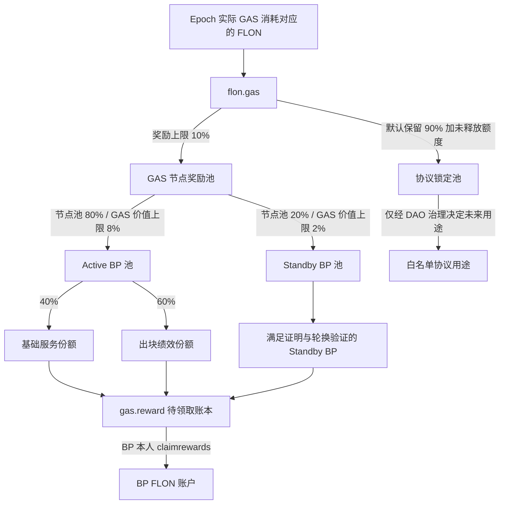

# FLON Gas 节点奖励设计

## 1. 目标与结论

每个结算周期（epoch）将链上**实际消耗 Gas 对应的 FLON** 的 10% 计入节点奖励池，由 21 个活跃节点和最多 30 个合格备用节点分享。设计必须满足：

- 所有共识节点从同一链上输入得到完全相同的账本结果；
- 不把 `flon.gas` 的充值或 `buygas` 金额误认为当期已消耗 Gas；
- 不按外部监控数据直接发币；
- epoch 边界只做常数时间封账；每个 BP 可重复触发但只能成功结算一次；
- 分配、领取、舍入余数和未分配余额始终守恒；
- 节点领取采用 pull 模式，不在 `onblock` 中遍历或转账，也不要求先完成全局批量结算。

当前实现只完成了 Gas 资产进入 `flon.gas` 的基础路径，尚未实现上述 10% 节点奖励闭环。`claimrewards` 当前也没有可用的节点领取实现。

节点奖励池使用独立合约账户 `gas.reward`。`flon.system` 负责确定资格、统计绩效和生成分配结果；`gas.reward` 接收 10% FLON、维护节点资金账本并处理领取。

## 2. 当前链上资产语义

`flon.gas` 实际持有 `flon.token` 发行的 FLON。Gas 是资源计量单位，不应再创建一个可流通的 ELON 作为中间奖励币。

当前存在两条进入 `flon.gas` 的路径：

1. `buygas`：用户预先把 FLON 转入 `flon.gas`，同时获得 reserved gas；
2. 原生资源扣费：当交易从流动 FLON 支付 Gas 时，core 直接把相应 FLON 从付款人余额移入 `flon.gas`。

因此不能简单使用 `flon.gas` 的余额增量作为“当期 Gas 消耗”：预付 Gas 在购买时增加余额，但可能在后续 epoch 才被消耗。

## 3. 收入确认

### 3.1 共识级累计计数器

在 core 的资源结算路径增加单调递增的共识状态：

```text
total_gas_consumed
total_gas_value_flon
```

- `total_gas_consumed`：实际结算的 Gas 原子单位累计值；
- `total_gas_value_flon`：按协议内确定性换算规则得到的 FLON 最小单位累计值；
- reserved gas 和流动 FLON 支付都只在**实际消耗发生时**累计一次；
- `buygas` 只改变预付余额，不增加已消费累计值；
- 失败交易按照协议实际计费结果累计；不计费的失败交易不得累计；
- 计数器进入 snapshot、重放和状态承诺路径。

通过受协议特性保护的只读 intrinsic 暴露：

```text
get_gas_fee_totals() -> {
  total_gas_consumed,
  total_gas_value_flon
}
```

系统合约只读取累计值，不接受预言机提交的 Gas 收入。

### 3.2 Epoch 收入

```text
epoch_gas_value = total_gas_value_flon(end) - total_gas_value_flon(start)
node_pool       = floor(epoch_gas_value * node_reward_bps / 10_000)
node_reward_bps = 1_000  // 10%
```

所有运算使用 FLON 最小单位和 `int128` 中间值。禁止浮点数。

## 4. Epoch 与资格快照

建议首版 epoch 为 6 小时。每个 epoch 开始时冻结：

```text
epoch_id
start_slot / end_slot
active_schedule_hash
active_nodes[]       // 最多 21
standby_nodes[]      // 最多 30
reward_parameters_hash
gas_total_start
```

节点集合必须来自上一 epoch 已完成的合格候选人排名，不能在结算时按最新票数回溯修改。活跃与备用账户不能重复出现。

## 5. 10% 奖励池分配

Epoch 封账后，各 BP 在首次独立结算时确定其额度；资金按以下路径移动：

```text
Gas 消耗对应的 100% FLON -> flon.gas
Epoch 节点份额 10%       -> gas.reward
协议保留份额 90%         -> 继续留在 flon.gas
节点领取                  -> gas.reward -> node
```

`flon.system` 中的分配记录是审计依据，不代表资金已经到账。只有 `gas.reward` 确认收到本期资金并完成入账后，节点余额才可领取。

建议初始参数：

| 奖励子池 | 占 Gas 对应 FLON | 占节点池 |
| --- | ---: | ---: |
| 活跃节点池 | 8% | 80% |
| 备用节点池 | 2% | 20% |
| 合计 | 10% | 100% |

比例由治理参数控制，但 `active_bps + standby_bps == node_reward_bps` 必须成立。

### 5.1 奖励池结构图



Active 与 Standby 的 80%/20% 是节点奖励池内部比例。节点不足时必须继续按 21/30 目标席位归一化，不能由少量 BP 瓜分全部 10%。GAS 节点奖励默认不进入投票人分享池；生产者基础挖矿奖励及其投票人分享属于另一条账路。

### 5.2 活跃节点

活跃节点必须按链上确定性的 `get_producer_slot_stats` 统计应出、实出和漏块：

```text
availability_i = produced_i / expected_i
```

活跃池再分为：

- 40% 基础服务份额：在达到最低出勤率的活跃节点间等额分配；
- 60% 出块绩效份额：按各节点 `produced_blocks` 占合格节点总实出块数的比例分配。

建议资格规则：

| Epoch 出勤率 | 奖励系数 |
| --- | ---: |
| `>= 99%` | 1.00 |
| `95%–99%` | 线性从 0.50 到 1.00 |
| `< 95%` | 0 |
| `expected_blocks` 不足最小样本 | 不处罚，不领取绩效份额 |

同一 epoch 超过三分之一活跃节点低于门限时，标记 `network_incident`：不自动处罚本金，奖励可暂缓到 DAO/timelock 复核，但原始统计必须永久保存。

### 5.3 备用节点

备用节点不在生产排班中，`expected_blocks == 0`，不能伪装成按出块率计奖。备用资格必须同时满足：

1. epoch 开始快照中属于前 30 名合格备用节点；
2. 自质押、metadata、签名密钥和 finalizer key（启用时）有效；
3. 在 epoch 内提交一次由节点 key 签名的 `standbyproof(epoch_id, head_block_id)`；
4. 最近的轮换观察期曾进入活跃排班，并达到最低出勤门限；超过 `standby_revalidate_epochs` 未轮换验证则暂停奖励。

`standbyproof` 只能证明密钥持有者跟随到指定链头，不能单独证明完整节点服务能力。因此首版备用池等额分配，但必须配合确定性轮换：每个 epoch 从 30 个备用节点中选若干进入竞争/观察席位，使其定期接受真实出块验证。

不满足资格的备用份额不重分给其他节点，留在 `flon.gas` 安全储备。

## 6. 舍入与守恒

每个子池采用 largest-remainder 或“最后一名吸收余数”的确定性算法。排序键固定为 `(权重降序, account.value 升序)`，禁止依赖容器迭代顺序。

必须满足：

```text
epoch_node_pool
  = sum(epoch_node_allocations)
  + epoch_unallocated
  + epoch_rounding_remainder

total_allocated
  = total_claimed
  + total_unclaimed
```

资金转入 `gas.reward` 后，任何时刻还应满足：

```text
gas.reward FLON balance >= total_unclaimed
```

若不满足，对应 BP 的独立结算必须失败，不能发行无资金支持的应付款。

## 7. 合约表与动作

### 7.1 表

```text
gasrewardcfg:
  node_reward_bps, active_bps, standby_bps,
  base_active_bps, performance_active_bps,
  epoch_slots, min_expected_blocks,
  standby_revalidate_epochs, paused

gasepochs:
  epoch_id, start_slot, end_slot, schedule_hash,
  gas_total_start, gas_total_end, gas_value,
  node_pool, active_pool, standby_pool,
  active_eligible, standby_eligible,
  active_settled, standby_settled,
  allocated, unallocated, status, params_hash,
  allocation_hash

nodeepochrwds:
  epoch_id, owner, role, expected, produced, missed,
  availability_ppm, weight, producer_amount, voter_amount,
  settled, claimed

noderewards:
  owner, total_allocated, total_claimed, unclaimed

standbyproofs:
  epoch_id, owner, head_block_id, submitted_at
```

`gasrewardcfg`、`gasepochs`、`nodeepochrwds` 和 `standbyproofs` 位于 `flon.system`。`nodeepochrwds` 建议按 epoch scope 存储，保留逐期审计证据。

`noderewards` 位于 `gas.reward`，是领取用累计资金账本。`gas.reward` 另存 `rewardepochs`，记录每期已封账资金、已独立结算总额、领取总额和守恒数据。Epoch 不以“全部 BP 已结算”作为后续 Epoch 开始或其他 BP 领取的前置条件。

### 7.2 动作

```text
openepoch(epoch_id)
accumstats(epoch_id, from_slot, to_slot)
standbyproof(epoch_id, owner, head_block_id, signature)
sealepoch(epoch_id)
settleprod(producer, max_epochs)
claimrewards(owner, max_epochs)
setgasrwcfg(...)
pausegasrw(bool)
```

- `openepoch` 通常由 `onblock` 在边界内联调用，只写快照；
- `accumstats` 在区块到达时只累计上次处理 slot 到当前 slot 之间受影响的活跃节点统计；正常出块时通常只更新一个节点，跨越漏块时才更新少数受影响节点；
- 更新节点前先从 epoch 聚合值减去该节点的旧贡献，更新 `expected/produced/missed` 和资格状态后再加入新贡献，从而增量维护 `active_eligible`、`failed_active` 和 `eligible_produced_total`；epoch 结束时不需要再扫描 21 个活跃节点来计算分母；
- `standbyproof` 到达时立即验证并把对应备用节点标记为本期合格，同时增加 `standby_eligible`，不在 epoch 结束时重新扫描证明；
- `sealepoch` 由 `onblock` 在 epoch 边界内联调用，只冻结 Gas 累计值、资格集合、奖励参数和计算分母；其复杂度必须为 `O(1)`，不得遍历 BP 或转账；
- `settleprod` 按时间顺序结算指定 BP 最多 `max_epochs` 个已封账 epoch。它是 permissionless，任何账户都可替该 BP 推进记账，但调用者无权领取或改变收款人；
- `claimrewards` 要求 BP 本人授权。它对该 BP 最多处理 `max_epochs` 个未结算 epoch，必要时先调用同一内部 `settle_producer_reward`，然后一次性领取其累计可领取 FLON；
- `nodeepochrwds` 的 `(epoch_id, owner)` 唯一键和 `settled/claimed` 状态保证每个 BP 每个 epoch 只结算、只领取一次；
- 一个 BP 未结算或未领取，不得阻塞其他 BP、投票人无关的奖励或下一 epoch 封账；不再需要全局 cursor、`settlenext` 或强制 `finalizeepoch`；
- 若生产者奖励包含投票人分享，独立结算同时把该 BP 的投票人份额记入 `voter.reward`。BP 长期不领取时，任何人可调用 `settleprod`，所以投票人权益不会被 BP 卡住；
- `settleprod` 只做账本记账，不向 BP 转账。所有面向最终受益人的 FLON 都由其本人调用 `claimrewards` 主动领取；
- 每次独立结算增加 epoch 的 `settled_count`、`allocated` 和 `unallocated` 聚合值。达到快照节点数时可以自动标记 `FULLY_SETTLED`，但该标记仅供审计，不是领取或开启下一 epoch 的门槛；
- `flon.gas` 到 `gas.reward` 的资金准备必须在封账时按上限预留，或在独立结算时按该 BP 的确定额度划拨；无论采用哪种方式，都必须先记账再转账并维持资金守恒；
- 参数变更只对下一 epoch 生效。

### 7.3 BP 独立惰性结算状态机

```text
OPEN
  ├── 每块 accumstats
  ├── 备用节点 standbyproof
  ↓ epoch 到期
SEALED                         // onblock 仅 O(1) 冻结事实
  ├── BP A: UNSETTLED -> SETTLED -> CLAIMED
  ├── BP B: UNSETTLED -> SETTLED -> CLAIMED
  ├── BP C: UNSETTLED -> SETTLED -> CLAIMED
  └── ...                     // 顺序任意，彼此不阻塞

settled_count == snapshot_node_count
  └── FULLY_SETTLED           // 可选审计标记，不是全局闸门
```

该模型将复杂度从“单笔交易 `O(51)`”改为“每个区块 `O(1)`、每个 BP/epoch 结算 `O(1)`”。`claimrewards` 只允许处理有界的历史 epoch 数；整个 epoch 总工作量仍为 `O(51)`，但由各 BP 或 permissionless 调用者按 BP 独立承担，不存在全局 batch cursor 或单个失联 BP 阻塞全局的问题。

## 8. 是否引入 ELON

不建议先发 ELON、再允许节点兑换 FLON，理由如下：

1. 当前 `flon.gas` 收到的真实资产就是 FLON；
2. ELON 若可兑换 FLON，会形成新的链上负债，必须额外维护储备率、兑换权限和挤兑处理；
3. 1:1 固定兑换会制造套利和会计重复；浮动兑换又需要价格预言机；
4. 节点收入、税务和浏览器展示都会多一层难以解释的资产；
5. 51 个节点记账准确依赖的是 epoch 快照和守恒账本，不依赖中间代币。

推荐做法：

- Gas 继续作为不可转让的资源额度；
- 奖励账本内部以 FLON 最小单位记账；
- 节点领取时直接从 `gas.reward` 获得 FLON；
- 如产品希望展示“待领取算力收益”，可显示不可转让的记账积分，但它不是 token，也不存在独立兑换市场。

## 9. 上线顺序

1. Core：增加 Gas 实际消耗累计计数器、snapshot/replay 支持及 feature-gated intrinsic。
2. CDT：暴露 `get_gas_fee_totals` 包装。
3. System contract：实现 epoch、21+30 快照、绩效计算和不可变分配记录。
4. `gas.reward`：实现 epoch 资金准备、节点累计余额和 `claimrewards`。
5. 测试：覆盖预付 Gas 跨 epoch、失败交易计费、重复结算、51 节点、节点不足、舍入、全网故障、fork/replay/snapshot。
6. 影子运行：测试网至少运行 30 天，只记账不转账，每日核对 `flon.gas`、`gas.reward`、累计消耗与奖励守恒。
7. 激活：所有生产、备用、API/history 节点先升级 core，再在统一高度激活 protocol feature，最后启用 10% 实际支付。

## 10. 验收不变量

- 同一 block log 在不同机器重放得到完全相同的 epoch 和节点奖励表；
- `buygas` 不会立即被当作已消费收入分走；
- 每笔实际 Gas 消耗只累计一次；
- 活跃节点奖励只依据排班快照与实际出块；
- 备用节点没有有效证明或超过轮换验证期时不能获奖；
- 21+30 节点顺序变化不影响总额与确定性；
- 重复调用 `sealepoch`、`settleprod`、`claimrewards`，以及 fork 回滚和 snapshot 恢复不会重复计奖或重复转账；
- 任一 BP 不结算、不领取都不会阻塞其他 BP或下一 epoch；
- 所有节点分配、未分配和舍入余数之和严格等于当期 10% 节点池；
- 实际领取总额永远不超过已关闭 epoch 的累计分配额。
